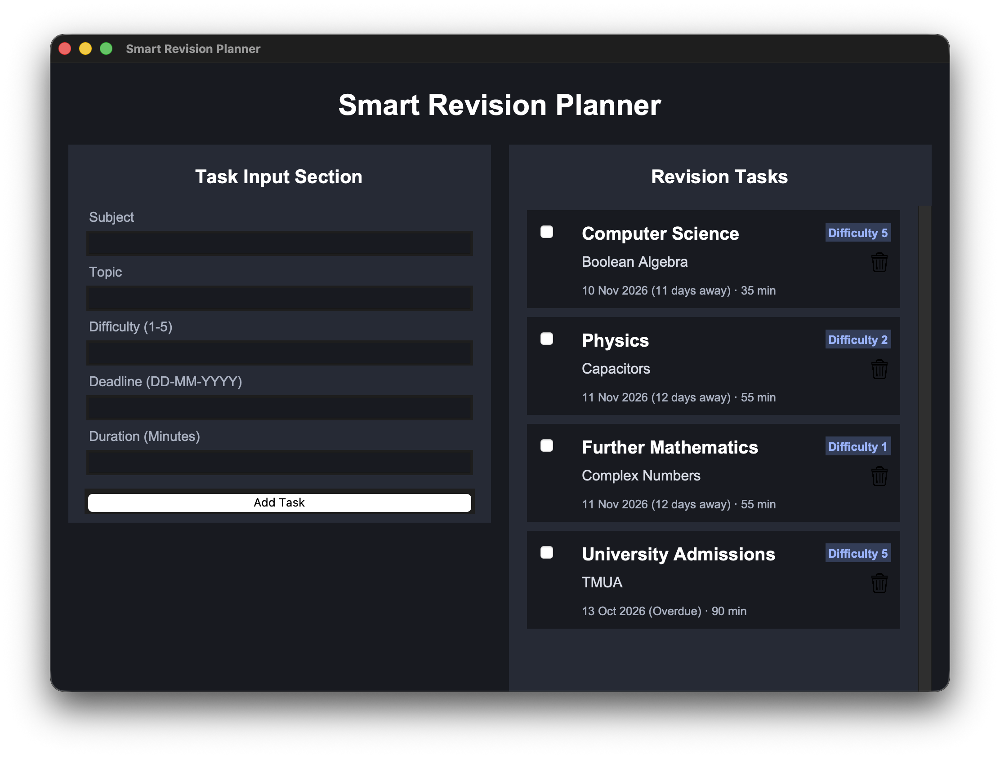

# Smart Revision Planner

A desktop revision planning application developed independently using Python and Tkinter. The application helps students organise their revision tasks and prioritise them based on difficulty, duration and upcoming deadlines.

## Features

- **Task management:** Add, complete and delete revision tasks.
- **Smart prioritisation:** Automatically rank tasks using a priority score calculated from task difficulty, estimated duration and time remaining until the deadline.
- **Automatic sorting:** Display tasks in descending priority order.
- **Data persistence:** Save and restore revision tasks using JSON.
- **Input validation:** Validate task difficulty, duration and deadline formats.
- **Graphical interface:** Dark-themed Tkinter interface with scrollable task cards.



## Prioritisation Algorithm

The application uses a custom priority-scoring algorithm:

**Priority = (Difficulty × Duration) / Days Until Deadline**

Tasks with higher scores are prioritised. Completed tasks receive a priority score of zero.

## Technologies

- Python
- Tkinter
- JSON
- Python `datetime` module

## Installation

1. Clone this repository.
2. Ensure Python 3 is installed with Tkinter support.
3. Navigate to the project directory.
4. Run the application:

   ```bash
   python code/main.py
   ```

   Depending on your operating system, you may need to use `python3` instead.

## Project Structure

- `code/main.py` — Main application and GUI logic.
- `images/` — Application icons and graphical assets.
- `data/` — Locally saved revision task information.

## Future Improvements

- Allow users to edit existing tasks.
- Introduce adjustable prioritisation weights.
- Add filtering by subject and completion status.
- Display revision progress and statistics.

## Author

Developed independently as a Python portfolio project.